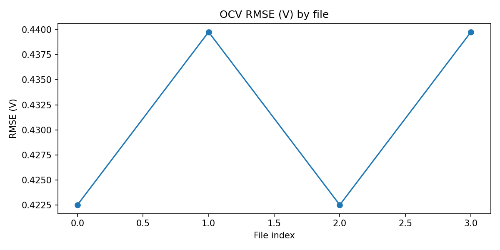
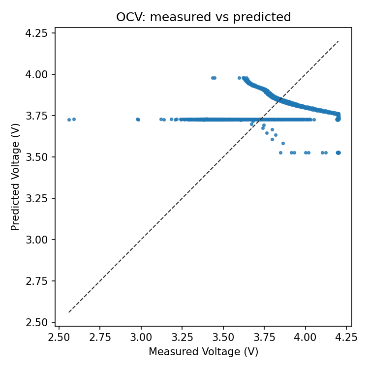
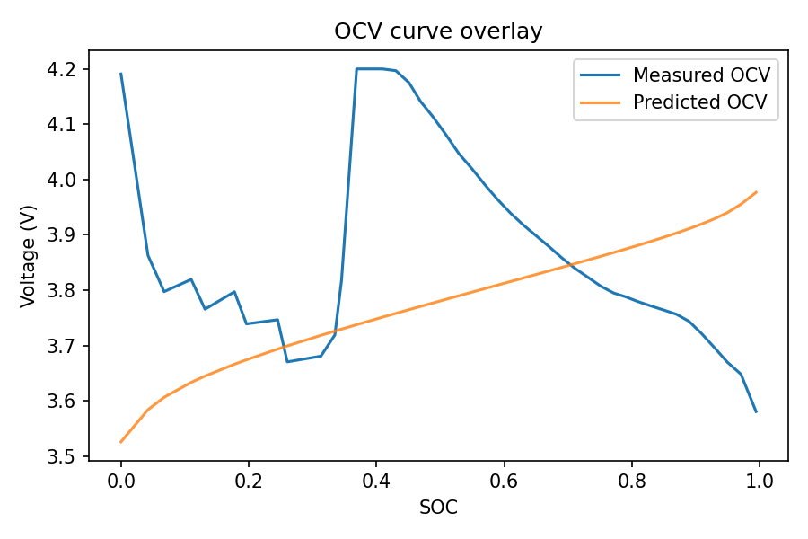
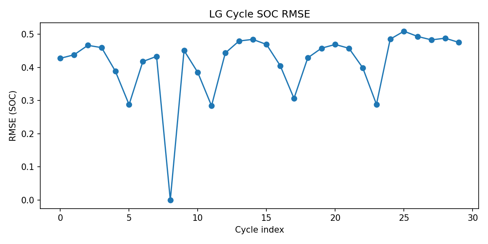
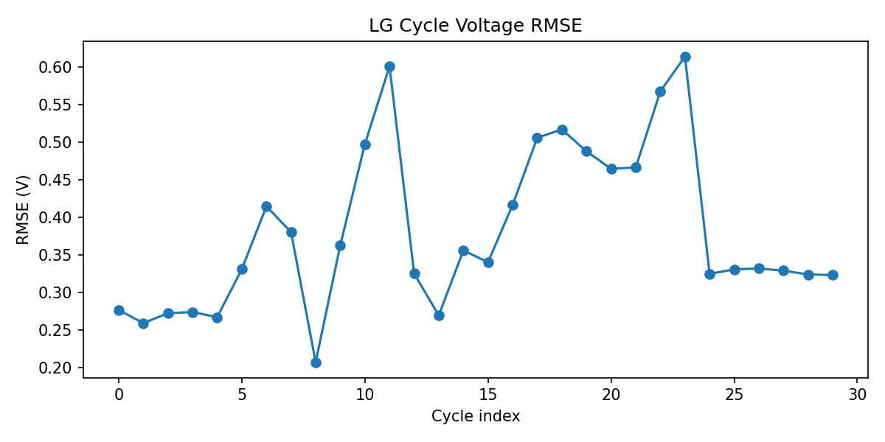
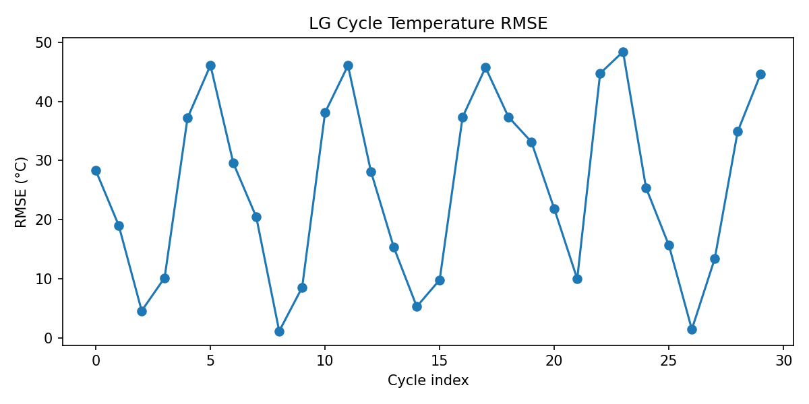
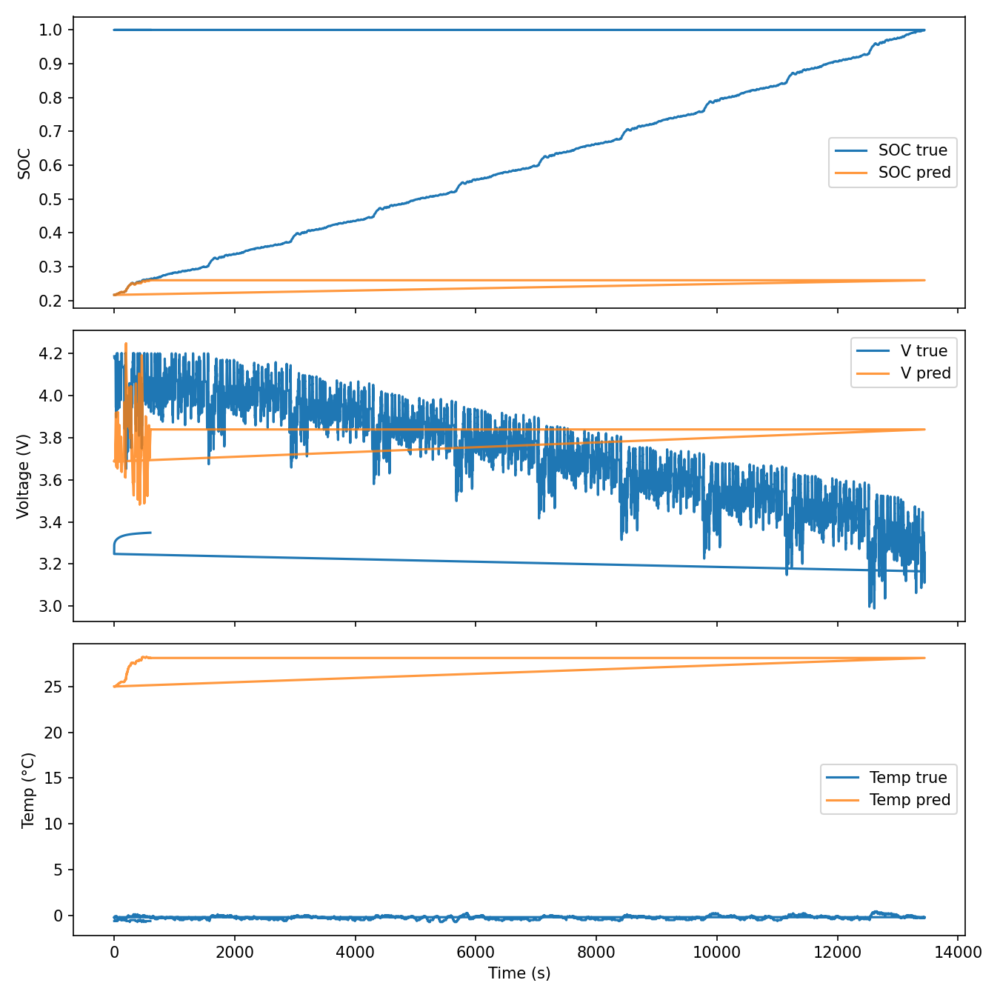
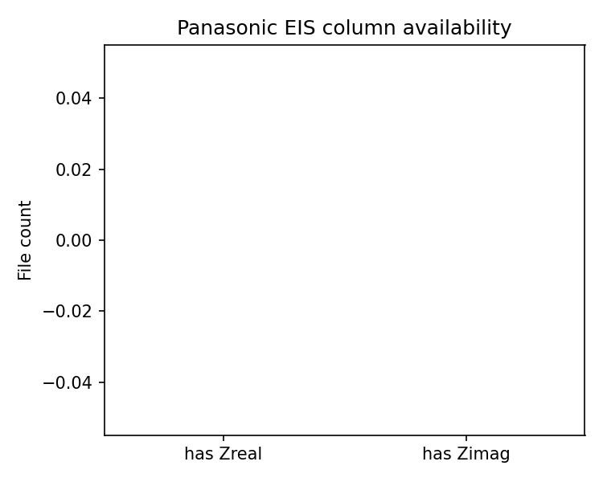
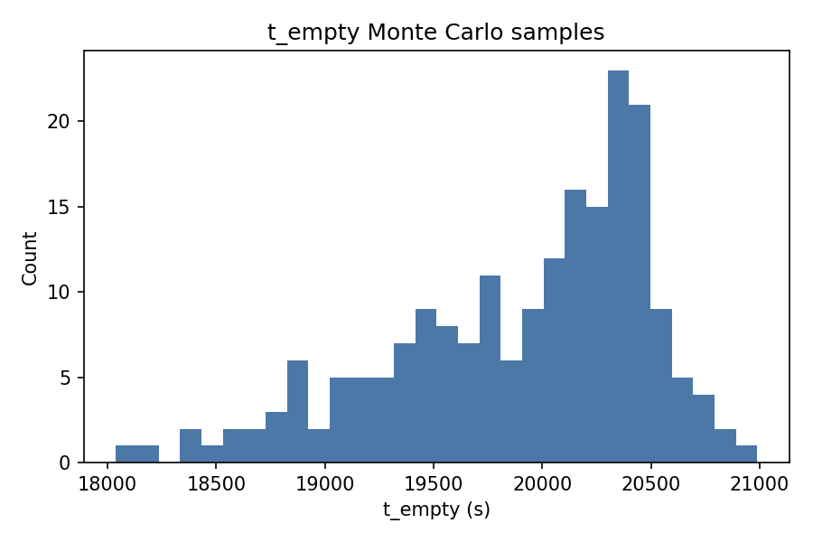

# 模型验证报告（自动生成）

由 `run_validation.py` 与 `plot_results.py` 自动生成。

## 目录
- [1. 数据集整理](#1-数据集整理)
- [2. 模型覆盖范围说明](#2-模型覆盖范围说明)
- [3. 实验与验证过程](#3-实验与验证过程)
  - [3.1 OCV–SOC 静态关系验证](#31-ocv–soc-静态关系验证)
  - [3.2 LG HG2 工况循环验证（SOC/电压/温度）](#32-lg-hg2-工况循环验证soc电压温度)
  - [3.3 Panasonic EIS 数据列可用性清单](#33-panasonic-eis-数据列可用性清单)
  - [3.4 空电时间不确定性（Monte Carlo）](#34-空电时间不确定性monte-carlo)
- [4. 输出文件说明](#4-输出文件说明)
- [5. 覆盖性与限制](#5-覆盖性与限制)
- [6. 复现步骤](#6-复现步骤)

## 1. 数据集整理
本次验证使用的相关数据集如下（详见 `dataset_inventory.csv`）：
- **LG HG2**：驱动工况循环（UDDS/HWFET/LA92/US06）、C/20、HPPC、Charge，包含多温度数据。
- **Panasonic PF**：包含 EIS 与多工况文件，用于阻抗数据列可用性检查。
- **OCV Excel**：低电流与增量电流开路电压实验数据。

## 2. 模型覆盖范围说明
当前模型（`model_impl.py`）包含：
- **OCV–SOC 关系**：`ocv(soc, T)`。
- **等效电路动态（SOC/电压/RC 分支）**：`battery_ode` 与 `simulate`。
- **热模型**：温升动态与对流换热 `h_eff`。
- **空电时间预测**：`predict_empty_time` 与蒙特卡洛 `monte_carlo_t_empty`。
- **衰老/阻抗增长**：`aging_model_rate`、`resistance_growth`。

本次验证已覆盖 **OCV 静态关系、SOC/电压动态、温度轨迹、空电时间统计**；
EIS 仅进行列可用性清单统计，未进行阻抗曲线拟合；
衰老模型与环境修正项（湿度/气压）当前缺少直接对应数据，未做定量验证。

## 3. 实验与验证过程

### 3.1 OCV–SOC 静态关系验证
**目标**：验证模型 OCV 曲线与实验开路电压数据的一致性。

**步骤**：
1. 遍历 `dataset/battery data` 下全部 OCV Excel 文件。
2. 对每个文件自动选择含 `Voltage`/`Current` 的数据表。
3. 读取 `Voltage(V)` 与 `Charge_Capacity(Ah)`，计算 SOC（以名义容量归一）。
4. 用 `model.ocv(soc)` 预测 OCV，计算 RMSE/MAE/Max Error。
5. 生成散点数据 `ocv_points.csv` 以便绘制“实测 vs 预测”对角线图。

**输出**：
- 指标表：`ocv_metrics.csv`
- 散点数据：`ocv_points.csv`

**图像解释**：
- 
  - 说明各 OCV 文件的误差分布，用于识别异常样本。
- 
  - 实测电压 vs 预测电压散点；点越接近对角线，模型 OCV 一致性越好。
- 
  - 在同一坐标中叠加 OCV–SOC 曲线（实测与模型预测），用于直观看出曲线偏移与形状差异。

### 3.2 LG HG2 工况循环验证（SOC/电压/温度）
**目标**：验证动态模型对 SOC、端电压及温度的跟踪能力。

**步骤**：
1. 选取 LG HG2 多工况文件（UDDS/HWFET/LA92/US06/C20/HPPC/Charge）。
2. 解析 CSV 表格，若存在 `Step Time/Prog Time` 则转秒，否则按行号生成时间。
3. 用容量序列 `Capacity(Ah)` 计算真实 SOC；功率由 `Power` 列或 `V*I` 得到。
4. 调用 `model.simulate` 得到 SOC、电压、温度轨迹。
5. 与实测序列对齐，计算 SOC/电压/温度 RMSE 与 MAE。
6. 额外输出一个代表性工况的时域轨迹用于直观对比。

**输出**：
- 指标表：`lg_cycle_metrics.csv`
- 代表性轨迹：`lg_sample_trace.csv`

**图像解释**：
- 
  - 各工况 SOC 误差分布。
- 
  - 各工况电压误差分布。
- 
  - 有温度数据时的温度误差分布。
- 
  - 代表性工况的 SOC/电压时域对比曲线，体现模型动态跟随能力。

### 3.3 Panasonic EIS 数据列可用性清单
**目标**：确认 EIS 文件是否包含阻抗实部/虚部列，为后续阻抗模型验证做准备。

**步骤**：
1. 遍历 Panasonic PF EIS 文件前 20 个样本。
2. 检查列名中是否包含与 Zreal / Zimag 对应的字段。
3. 输出可用性统计表，并绘制柱状图。

**输出**：
- 清单表：`panasonic_eis_inventory.csv`

**图像解释**：
- 
  - 显示 EIS 文件中阻抗实/虚部列的可用数量（当前样本中为 0）。

### 3.4 空电时间不确定性（Monte Carlo）
**目标**：评估空电时间预测的随机扰动敏感性。

**步骤**：
1. 设定 SOC_0=0.8、温度 298.15 K、负载 1500 mW。
2. 对 SOC 与 SOH 施加高斯扰动，进行 200 次抽样。
3. 输出 t_empty 样本分布。

**输出**：
- `uncertainty_samples.csv`

**图像解释**：
- 
  - 展示空电时间预测的分布与离散程度。

## 4. 输出文件说明
- `dataset_inventory.csv`：数据集目录与说明
- `ocv_metrics.csv`：OCV 文件级误差
- `ocv_points.csv`：OCV 实测/预测散点
- `lg_cycle_metrics.csv`：LG HG2 工况 SOC/电压/温度误差
- `lg_sample_trace.csv`：代表性工况时域轨迹
- `panasonic_eis_inventory.csv`：EIS 列可用性
- `uncertainty_samples.csv`：t_empty Monte Carlo 样本
- `summary.json`：总体汇总指标

## 5. 覆盖性与限制
- **已覆盖**：OCV–SOC 静态关系、SOC/电压动态、温度轨迹、空电时间不确定性。
- **部分覆盖**：EIS 仅统计列可用性，缺少 Zreal/Zimag 列无法进行阻抗曲线拟合。
- **未覆盖**：衰老模型（SOH 演化）与环境修正（湿度/气压）缺少对应实验数据，未做定量验证。
- **采样限制**：LG 工况默认抽取 30 个文件进行验证，完整验证可适当放宽限制。

## 6. 复现步骤
在 `D:\jingsai\shumo\MCM\2026A\model\compare` 下执行：
1. `python run_validation.py`
2. `python plot_results.py`
